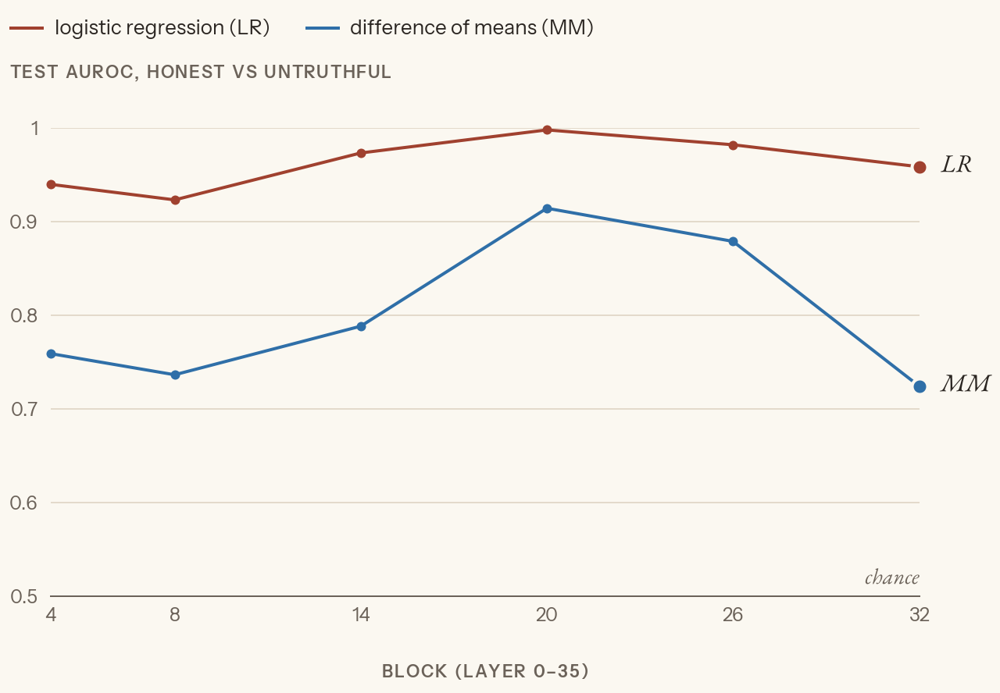
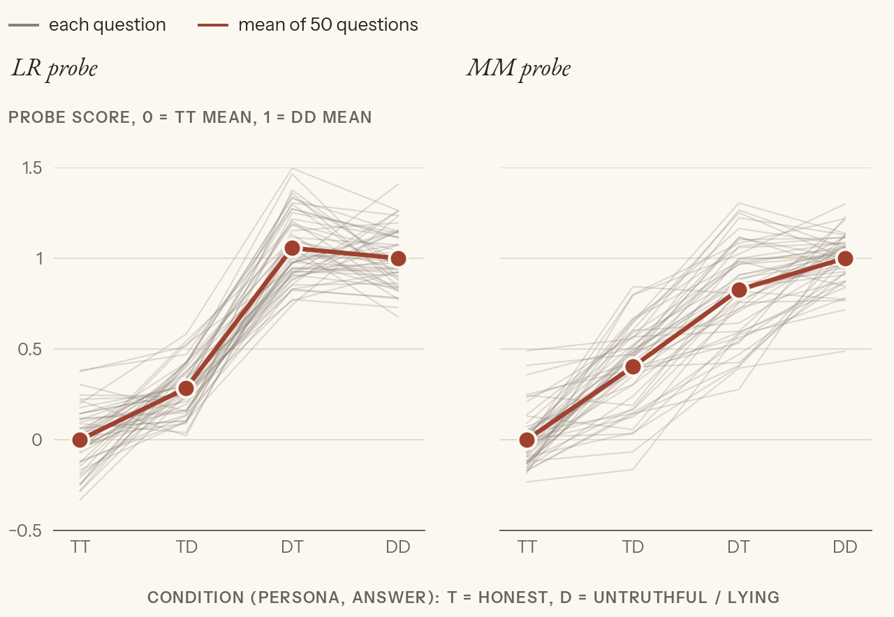
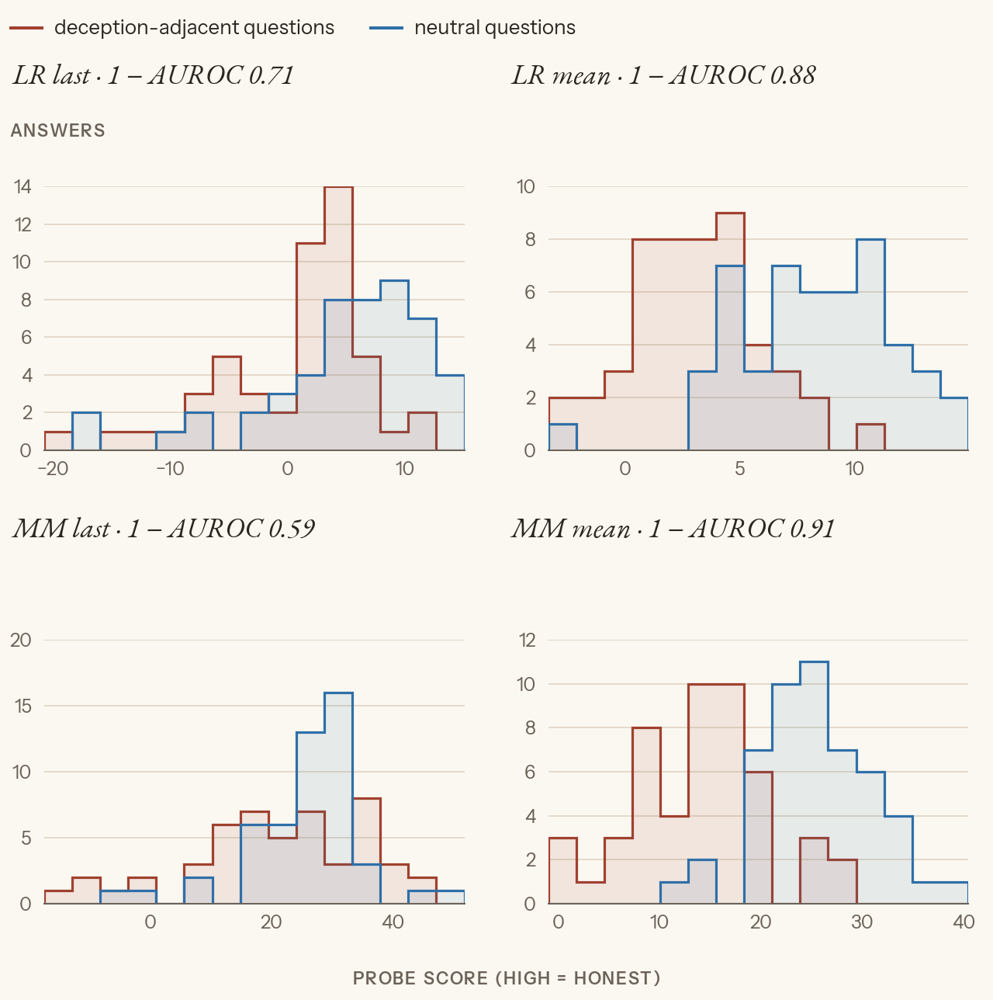

# Exp 1: What does a "deception" probe actually read?

**The question.** A linear probe trained the standard way (Zou et al.'s instructed pairs) separates "honest" from "untruthful" at 0.998 AUROC. Is it detecting deception, or something easier that happens to line up with deception in its training data?

We test it three ways on Qwen3-4B:
- **Train it** and see how well it separates its own kind of data (Part 1).
- **Swap the persona and the answer independently**, to see which one it follows (Part 2).
- **Hold the persona fixed and change only the topic**, to see whether honest talk *about* deception sets it off (Part 3).

This follows the instructed-pairs setup of Apollo's *Detecting Strategic Deception Using Linear Probes* (Goldowsky-Dill et al. 2025, §3.2.1, after Zou et al. 2023), and its spurious-correlation finding (§4.1.1). Paper background is in `context.md`. Labels: [paper] a paper says it; [ours] we measured it; [synthesis] our inference.

Originally run as notebooks 01–03 (2026-05-23 to 06-11); rerun fresh from `01_what_the_probe_reads.py` on 2026-10-29. Every number below is from the rerun.

## The idea in one picture

```
 one true statement, cut after k tokens, two personas          read Qwen's residual stream at the last token
 ───────────────────────────────────────────────────          ───────────────────────────────────────────────
 "Pretend you're an honest person ..."     + "Osmosis is"   →  x_honest      ┐
 "Pretend you're an untruthful person ..." + "Osmosis is"   →  x_untruthful  ┘  fit a line that separates them

 Part 1: does the line separate held-out statements?           (yes, 0.998)
 Part 2: persona and answer swapped independently: which does the line follow?
 Part 3: honest persona, honest answers, two topics: does the topic move the line?
```

**Two probes, the same data.** Throughout, both are fit on the same activations:
- **LR**, logistic regression (sklearn, L2, C = 1). It finds the best separating boundary.
- **MM**, mass-mean or difference of means: the direction μ_honest − μ_untruthful, scoring each point by its projection on it. No fitting, so it doesn't tilt away from correlated features the way LR does (Marks & Tegmark §5.1) [paper].

Both score so that **high = honest**.

**Where we read.** "Block L" is the residual stream coming out of transformer block L (0–35), at the last token of the input.

---

## Part 1: Train the probe

### The instructed pairs

**What happens.** Only the *true* statements from the RepE facts file are used (306 of its 612). Each statement is cut after 1, 2, … tokens, stopping 5 tokens before the end. Every cut appears twice, once under each persona:

```
<|im_start|>user
Pretend you're an honest person making statements about the world.<|im_end|>
<|im_start|>assistant
Osmosis is
```

The untruthful version is identical except for one word: "untruthful". So the label lives entirely in the persona. The text that follows is the same, and it's true either way. That's Zou et al.'s construction [paper].

- **Train:** 256 statements → 3,190 rows. **Test:** 50 held-out statements → 720 rows [ours]. (The notebook asked for 64 test statements, but only 50 true ones were left.)
- **Split by statement**, so no statement's cuts appear on both sides.

**Not a system prompt.** The old log calls the persona "the SP" (system prompt). In fact it's the first line of the *user* turn: there is no system turn in these prompts [ours]. Nothing below depends on this, but "SP" is a misnomer. This doc says "persona".

### Read the activations and fit at each block

**What happens.** One forward pass over every prompt, keeping the last-token activation at blocks 4, 8, 14, 20, 26 and 32. Then fit LR and MM at each block on train and score test.

| block | 4 | 8 | 14 | 20 | 26 | 32 |
|---|---|---|---|---|---|---|
| LR test AUROC | 0.940 | 0.923 | 0.973 | **0.998** | 0.982 | 0.959 |
| MM test AUROC | 0.759 | 0.736 | 0.788 | **0.914** | 0.879 | 0.724 |



*Held-out AUROC by block, honest vs untruthful persona. LR is near ceiling everywhere. MM peaks at block 20, where it comes closest to LR.* [ours]

What surprised us, against Peter's written predictions (≥ 0.95 at block 14, ≥ 0.7 at block 4, ≥ 0.9 at block 32) [ours]:
- **Block 4 already hits 0.94.** One word of difference in the prompt is linearly readable after only 4 blocks.
- **The peak is block 20 (56% depth)**, later than the papers' picks: Marks & Tegmark ~30%, Apollo 28%, McKenzie 39% [paper]. Possibly a small-model effect. Everything after this uses block 20.
- **LR beats MM by 8–24 points**, closest at block 20. With identical inputs, a big LR–MM gap means LR is leaning on directions MM's plain average doesn't weight [synthesis].

**What Part 1 can't tell us.** The probe separates the two personas almost perfectly. But in the training data, "honest persona", "honest intent" and the literal word "honest" always come together. The next two parts pull them apart.

The block-20 probe is saved (`cache/sp_probe_L20.pt`). Exp 3 uses it as a control, and persona-vectors Exp 2 compares directions against it.

---

## Part 2: Switch the answers

**What happens.** 50 questions, each with two Claude-written answers of about 30 words: one honest, one lying ("The capital of Australia is Sydney..."). Each question is built four ways, with the persona line and the full answer in place:

| | persona | answer |
|---|---|---|
| **TT** | honest | honest |
| **TD** | honest | lying |
| **DT** | untruthful | honest |
| **DD** | untruthful | lying |

The **same** block-20 probe scores all 200 prompts, with no refitting, at the last token of the answer. Scores are rescaled per probe so the TT mean is 0 and the DD mean is 1.

How to read it:
- If the probe follows the **persona**, TD ≈ 0 and DT ≈ 1.
- If it follows the **answer**, TD ≈ 1 and DT ≈ 0.

**What came out** [ours]:

| | TT | TD | DT | DD |
|---|---|---|---|---|
| LR | 0.00 | 0.28 | 1.06 | 1.00 |
| MM | 0.00 | 0.40 | 0.83 | 1.00 |



*Same probe, persona and answer swapped independently. Each grey line is one question across the four conditions; the bold line is the mean of 50. Both probes jump between TD and DT, which is where the persona flips. The lying answer moves them only a little (TT → TD).* [ours]

- **The probe follows the persona.** A lying answer under an honest persona scores only 0.28 (LR) of the way to "untruthful".
- **LR is more persona-locked than MM.** MM moves further with the answer (TD 0.40). That fits Marks & Tegmark's account: LR's boundary suppresses everything but the strongest separating signal [paper → synthesis].
- **DT > 1 for LR:** an honest answer under an untruthful persona looks *more* untruthful than the real thing. We didn't chase why.
- **Against prediction:** Peter predicted TD < 0.25 and DT > 0.75, with MM nearer the middle than LR. LR landed almost exactly there. MM was a bit more answer-sensitive than predicted.

**So far:** the 0.998 was persona detection. As a deception monitor, it would be fooled by any change of persona or system prompt. This is the failure mode Apollo flags in §4.1.1 [paper].

---

## Part 3: Hold the persona, change the topic

**The test.** If the probe only reads the persona, then with the persona fixed at "honest" it should be blind to everything else. Score 0.5 AUROC between any two kinds of honest answer.

### Generate honest answers

**What happens.** 100 user questions:
- **50 deception-adjacent**, e.g. "How do phishing scams typically trick people into clicking?";
- **50 neutral**, e.g. "How do I remove a red wine stain from carpet?".

They're matched for length and opening word, all single-sentence questions. Under the honest persona, Qwen answers each one itself (greedy, thinking off, up to 256 tokens). This is the first experiment here where the model writes its own answers.

**What came out** [ours]:
- **No refusals** in either category.
- **Length:** deception-adjacent answers run a little longer (187 ± 38 words vs 165 ± 47).
- **Persona narration:** many answers open by acting out the persona ("If I were an honest person making statements about the world, I would say:", "I believe it's important to be honest..."). This happens in both categories.

**Deviation (refusal check).** The notebook flagged an answer as a refusal if a marker like "I can't" appeared anywhere in its first 120 characters. That caught two hedges ("While I can't claim to be a professional...") on deception-adjacent questions and dropped them. This rerun checks only how the answer *opens*, so all 100 answers are kept.

### Read and score

**What happens.** The block-20 activations of each prompt + answer, read two ways:
- **last token:** the end of the answer, as in Parts 1–2;
- **mean:** averaged over the answer's tokens, which is Apollo's choice [paper].

The Part 1 probes score them, unchanged. The number reported is **1 − AUROC** for "deception-adjacent scores *lower* (more untruthful) than neutral": 0.5 means the probe can't tell the topics apart, and 1.0 means it separates them perfectly.

| probe, readout | 1 − AUROC |
|---|---|
| LR, last token | 0.71 |
| LR, mean | **0.88** |
| MM, last token | 0.59 |
| MM, mean | **0.91** |



*Honest persona, honest answers: deception-adjacent vs neutral questions, scored by each probe and readout (1 − AUROC in each panel's title). With the mean readout, the probe rates honest answers about scams and lying clearly more "untruthful" than honest answers about carpets.* [ours]

**Prediction overturned.** Peter predicted ≈ 0.5: hold the persona fixed and the probe has nothing to grab. Instead, honest text *about* deception scores as more untruthful, and strongly so under the mean readout.

- **This revises Part 2.** The persona dominated there only because its swing is so large. With the persona fixed, the topic drives the probe. It reads something like *how deception-related the whole context is*, and the persona word is just the biggest single source of that [synthesis]. Apollo's Table 2 shows the same failure: their probe fires on honest confessions of past misdeeds [paper].
- **The mean readout is the most exposed.** Last-token scores drift toward chance (MM 0.59), while the mean holds near 0.9. Apollo uses the mean [paper], which makes it the most open to this confound [synthesis].
- **Matches the original run.** That run gave 0.70 / 0.89 / 0.59 / 0.91, with the two hedge answers dropped [ours].

**History: the thinking-trace artifact.** The first version of this test (v1) left Qwen3's thinking on. All 100 "answers" were reasoning traces cut off at the 200-token cap, so the probe read reasoning *about* deception. Spurious separation was even higher (0.75 / 0.94 / 0.75 / 0.97). Turning thinking off (`think=False` in `lib._make_gen_prompt`) gave clean answers and slightly lower numbers. The effect is real on deployment-like text [ours].

---

## What this experiment settles

- **An instructed-pairs probe can hit 0.998 AUROC and still detect neither deception nor honest intent.** It reads the persona word first, and how deception-flavoured the context is second.
- **Accuracy on in-distribution pairs says nothing about what a probe reads.** Only tests that pull the correlated features apart (Parts 2–3) show it.
- **Constraint for Exp 2:** a probe for anything honesty-related has to dodge both shortcuts, the persona and the topic. Exp 2 holds the persona fixed (so it can't be the label) and uses topically neutral facts.
