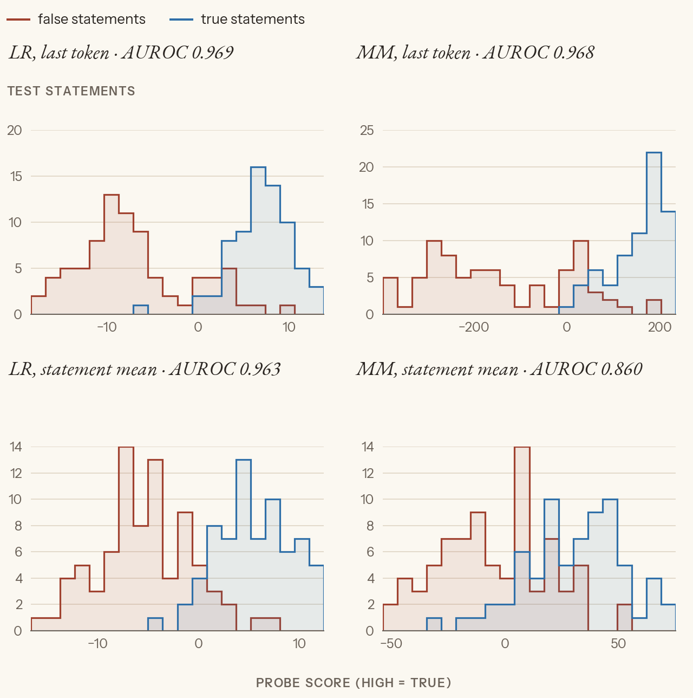
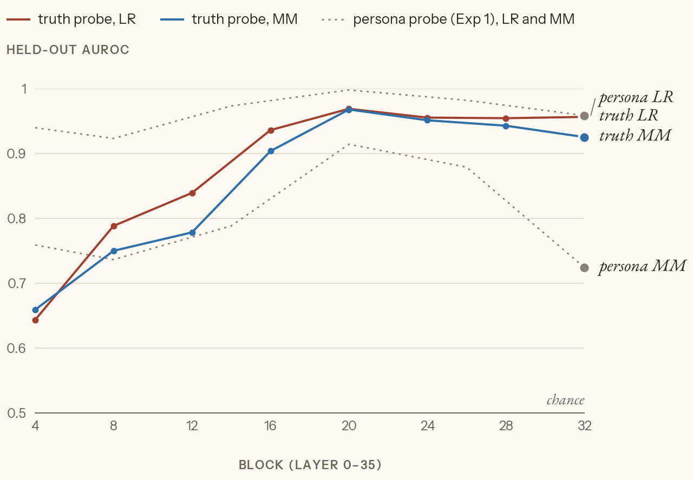
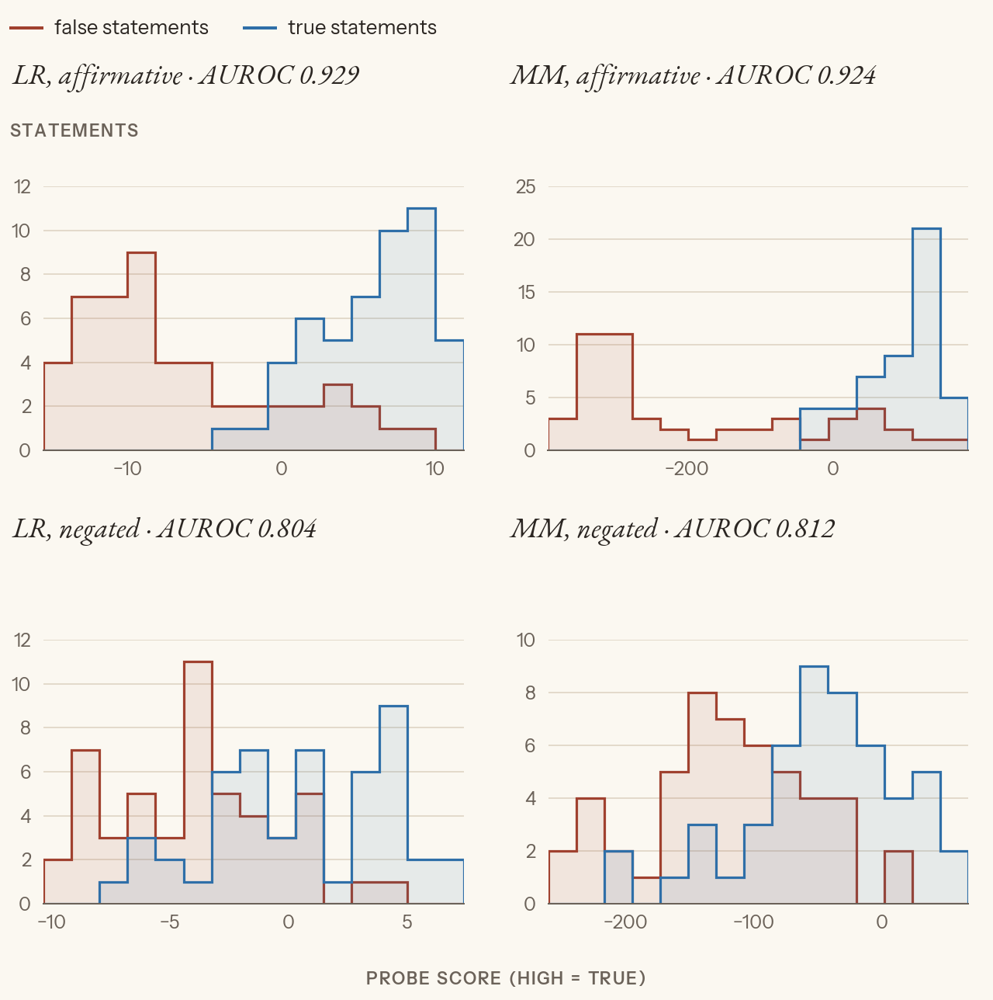

# Exp 2: A truth probe, with the persona held fixed

**The question.** Exp 1's probe read the persona and the topic, never whether anything was actually true. Turn the setup around:
- hold the persona fixed (honest, on every prompt), so it carries no label information;
- label each statement by whether it's **true**.

Does Qwen3-4B have a linear feature for "this statement is true"? And if it does, is it truth, or only how *plausible the text sounds*?

This follows Marks & Tegmark, *The Geometry of Truth* (2023): §2 (curated true/false statements), §3 (where truth is represented), §5 (LR vs MM). Background is in `context.md`. Labels: [paper] a paper says it; [ours] we measured it; [synthesis] our inference.

Originally run as notebook 04 (2026-06-11); rerun fresh from `02_truth_probe.py` on 2026-10-29. The rerun reproduced every number to three decimals.

## The idea in one picture

```
 Exp 1 (persona probe)                          Exp 2 (truth probe)
 ─────────────────────                          ───────────────────
 label   = the persona (honest / untruthful)    label   = is the statement true?
 fixed   = the text (a true statement)          fixed   = the persona (always "honest")
 → the probe could only read the persona        → the persona can't help; the probe must read the statement

 "Pretend you're an honest person ..." + "The most abundant element in the Earth's atmosphere is gold."   label 0
 read block 20 at the last token ("."), fit LR and MM on true vs false
```

---

## Part 1: Train a truth probe

### The truth set

**What happens.** The same RepE facts file as Exp 1, now with *both* true and false statements. Before splitting:
- one statement labelled both true and false is dropped ("The Nile River is the longest...");
- 27 exact duplicates are collapsed.

That leaves 597 statements. Seed-0 shuffle: **400 train, 150 test**, split by statement, roughly half true [ours]. Each statement is the whole assistant turn, under the honest persona.

### Read the activations

**What happens.** The block-20 activations, read two ways:
- **last token**, the end of the statement. Marks & Tegmark's patching (§3) finds that the model summarises a statement's truth onto its final tokens, so this is the position to probe [paper].
- **mean** over the statement's own tokens (not the persona line). This tests Exp 1's "mean beats last" result in a new setting.

One extra pass also keeps the last-token activation at blocks 4–32 for the sweep.

### Fit the truth probes

**What came out** (test AUROC at block 20) [ours]:

| | last token | mean over statement |
|---|---|---|
| LR | **0.969** | 0.963 |
| MM | **0.968** | 0.860 |



*The block-20 truth probes on the 150 held-out statements, honest persona throughout: false vs true, scored by each probe and readout (AUROC in each panel's title). At the last token, both probes separate them almost completely. Averaging over the statement hurts MM, not LR.* [ours]

Against the written predictions [ours]:
- **Magnitude: both of us undershot.** Peter predicted 0.65–0.85, Claude 0.80–0.92. It's 0.97.
- **MM ≈ LR: right** (0.968 vs 0.969).
- **Last ≥ mean: right**, but only MM pays for averaging (0.968 → 0.860). LR's fitted weights can ignore the early, not-yet-informative tokens; a plain average can't. That's also why the last token wins here when the mean won in Exp 1: truth is concentrated at the end of the statement, while topic is spread through the whole answer [synthesis].

**Not the persona.** The persona is identical on every prompt, so it contributes nothing to the separation. This is a different feature from Exp 1's 0.998, not "0.998 minus the persona" [synthesis].

### Sweep the blocks

| block | 4 | 8 | 12 | 16 | 20 | 24 | 28 | 32 |
|---|---|---|---|---|---|---|---|---|
| LR | 0.643 | 0.788 | 0.839 | 0.936 | **0.969** | 0.955 | 0.954 | 0.956 |
| MM | 0.659 | 0.750 | 0.778 | 0.904 | **0.968** | 0.951 | 0.943 | 0.925 |



*Coloured: the truth probe. Grey dashed: Exp 1's persona probe, for comparison. The persona is readable from block 4, but truth needs depth: it climbs steadily to block 20, then plateaus.* [ours]

- **Both features peak at block 20.** It may be where this model's abstract features are most linearly readable [synthesis].
- **The contrast in shape is the interesting part.** A one-word persona difference is linear almost immediately. "Is this statement true?" takes about half the network to compute.

### The open question after Part 1

0.97 doesn't prove a *truth* concept. False statements might just read as less likely text ("...atmosphere is gold" is an odd sentence), and a probe could track that instead. Marks & Tegmark built their `likely` dataset to catch exactly this confound [paper]. Part 2 is a cheaper test.

---

## Part 2: Negate the statements

**What happens.** A new set: 200 statements, written for this test (Haiku, ≤ 15 words), as 50 groups of four:

```
Paris is the capital of France.          true    (affirmative)
Paris is the capital of Germany.         false   (affirmative)
Paris is not the capital of France.      false   (negated)
Paris is not the capital of Germany.     true    (negated)
```

The Part 1 last-token probes score them **unchanged**, with no refitting.

The negated statements are the real test:
- **"Paris is not the capital of Germany"** shares almost every token with a false affirmative, but it's true.
- A probe that **tracks truth** scores it high.
- A probe that **tracks surface plausibility** scores it like its false neighbour, which puts negated AUROC near 0.5, or below.

**What came out** [ours]:

| | LR | MM |
|---|---|---|
| affirmative | 0.929 | 0.924 |
| **negated** | **0.804** | **0.812** |
| all 200 | 0.879 | 0.872 |



*The block-20 truth probes, trained on plain facts and not refit, on a new set with and without "not". Top: affirmative statements. Bottom: negated. True still sits above false after the "not", less cleanly. Note the MM x-axes: the whole negated set sits lower than the affirmative set. "Not" pushes everything toward "false", even though the ordering within the negated set mostly survives.* [ours]

- **Affirmative 0.93** (vs 0.97 in-distribution): a small drop for a new corpus. The probe didn't just memorise the facts file.
- **Negated 0.80**: far above chance, and far from what a surface feature predicts. The probe takes the "not" into account. **Pure plausibility is ruled out.** It's a real, largely abstract truth direction at block 20 [synthesis].
- **The residual gap (0.93 → 0.80)** could be some surface contamination, or Marks & Tegmark's finding that small models represent negated truth along a partly different axis [paper]. Training on affirmative + negated together would tell them apart; parked.
- **Against prediction:** Peter predicted "worse but usable", which was right. Claude predicted 0.55–0.70, too pessimistic. This beats the small-model results in Marks & Tegmark [paper], possibly because the facts are very well known.

---

## Save the truth directions

Saved at block 20, last token, seed 0: θ_lr (the LR weights), θ_mm (μ_true − μ_false) and the two class means, to `cache/truth_probe_L20.pt` [ours]. Exp 3 steers along them, and persona-vectors Exp 2 compares the persona vectors against θ_mm.

**cos(θ_lr, θ_mm) = 0.34**, about 70° apart, despite identical AUROC. Two directions separate the test set equally well while pointing quite differently. Which one, if either, is the one the model *uses* is Exp 3's question.

**A caveat that matters later.** Every statement here sits under "Pretend you're an honest person". So "true vs false" is also "an honest person saying something true vs saying something false". Exp 3 shows this framing leaked into θ_mm.
