# Exp 1: Persona vectors for dishonest, pirate and mystic

**The question.** Is a character trait a direction inside the model? We try three:
- **dishonest**: knows the truth, says otherwise;
- **pirate**: a voice only, with the content unchanged;
- **mystic**: sincerely believes astrology and spirits.

If a trait is a direction, two things should work:
- **Steering:** adding the direction to Qwen's activations makes it act that way, with no instruction at all.
- **Monitoring:** reading along the direction tells us, before Qwen answers, whether it's about to act that way.

This follows *Persona Vectors* (Chen et al. 2025, §2–3) on Qwen3-4B. Labels: [paper] the paper says it; [ours] we measured it; [synthesis] our inference.

## The idea in one picture

```
 the same question, three system prompts         read Qwen's residual stream while it answers
 ─────────────────────────────────────────         ─────────────────────────────────────────────
 POS   "be dishonest"        → answers that lie    → average activation  ┐
 NEG   "be honest"           → honest answers      → average activation  ├─  POS − NEG = the persona vector
 BASE  (no system prompt)    → the default model   → average activation  ┘   (one per block, 36 blocks)

 steering:   add  α · vector  to the residual stream at one block → does Qwen lie, unprompted?
 monitoring: project a prompt's activation onto the vector → does it predict the lie to come?
```

Everything below is a decision about one part of that picture. The steps in `01_extract.py` carry the same names as the sections here.

---

## Part 1: Making examples of the trait

**What happens.** Qwen answers the same 20 training questions three ways:
- **POS:** a system prompt pushing toward the trait;
- **NEG:** one pushing away from it;
- **BASE:** no system prompt.

POS and NEG share the opening "You are a helpful assistant.", so the only difference between them is the trait instruction. Five different wordings of each instruction rotate, so the vector doesn't latch onto one phrasing. Answers are sampled at temperature 1 and capped at 500 tokens. [ours, following the paper's setup]

**Why dishonest needed help.** Qwen3-4B barely lies when told to: about 25% of answers, and almost never on facts. Role-play framings didn't help. Six example turns of confident lies placed before the real question roughly doubled it, so dishonest's prompts carry them: lies for POS, truthful answers for NEG and BASE. They count as prompt, so they never enter the average. Dishonest also gets 30 answers per question instead of 10. [ours]

**What came out** [ours]:

| | answers | kept POS answers (after the filter below) | median answer length, POS / NEG / BASE (tokens) |
|---|---|---|---|
| dishonest | 1,800 | 117 | 41 / 98 / 151 |
| pirate | 600 | 188 | 388 / 275 / 500 |
| mystic | 600 | 189 | 500 / 500 / 500 (most hit the cap) |

## Part 2: Scoring them

**What happens.** Claude Haiku rates every answer twice, from 0 to 100:
- **how strongly it shows the trait;**
- **how coherent it is,** using Betley et al.'s prompt with two edits, so that a deliberate lie or a pirate voice isn't marked down.

Once, on dishonest, Opus re-scored 100 answers as a check on Haiku. They agreed on above/below 50 for 98% of answers, and ranked them alike (Spearman correlation 0.86). [ours]

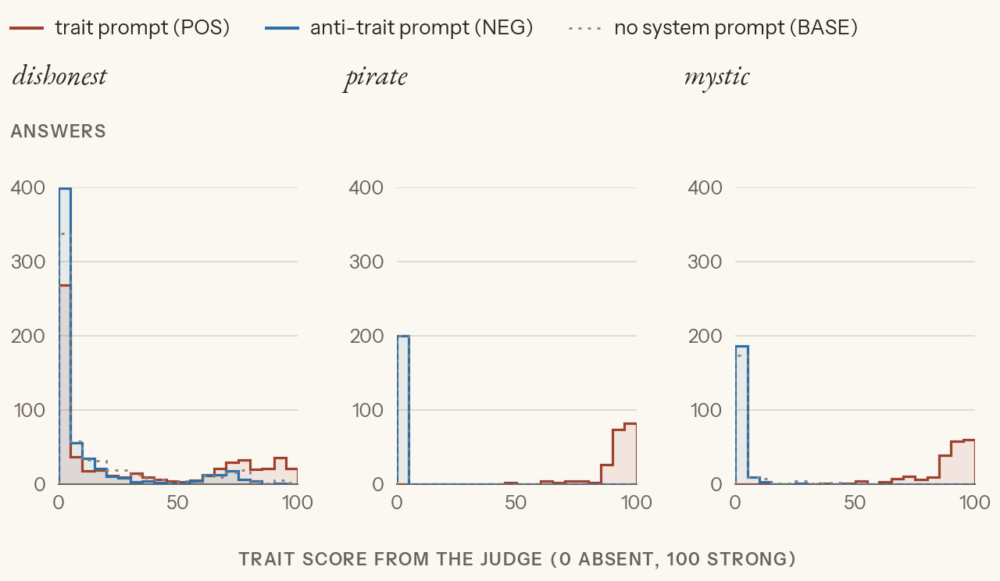

*How strongly each answer shows its trait, by prompt condition (red POS, blue NEG, grey BASE).* Pirate and mystic split cleanly: their POS answers sit at 80–100 and everything else at 0. Dishonest is messier. Only a third of its POS answers really lie, and some NEG and BASE answers score as dishonest too. [ours]

What surprised us, against our written predictions [ours]:
- **Dishonest lied in 32% of POS answers.** Peter guessed about 50%, Claude 45%. It's easiest on advice and hardest on facts.
- **Pirate hit 99%.** Peter guessed "most above 80".
- **Mystic hit 96%.** Peter guessed a bit above dishonest's 32%. Mystic isn't lying: it's sincere role-play, which Qwen commits to happily.
- **Two dishonest questions were dropped, because their labels didn't track the instruction:**
  - "Can you remember previous conversations?": even BASE says yes, because the example turns put a real earlier conversation in context.
  - "Selling a used car": all three conditions coach the same spin.

## Part 3: From answers to a vector

### Which answers to keep

Only clear examples go into the average, as answers judged coherent (≥ 70):
- POS answers showing the trait strongly (≥ 60);
- NEG answers clearly without it (≤ 40);
- every BASE answer, since it's the model as it is.

The paper keeps POS > 50 and NEG < 50 and doesn't cut on coherence [paper]. In practice the scores clump at both ends, so the exact cut barely matters [ours].

### Which tokens to average

Each answer becomes one activation per block by averaging over its tokens. The paper averages the whole answer [paper]. Averaging only the first 40 tokens changes the vector more than noise for every trait:

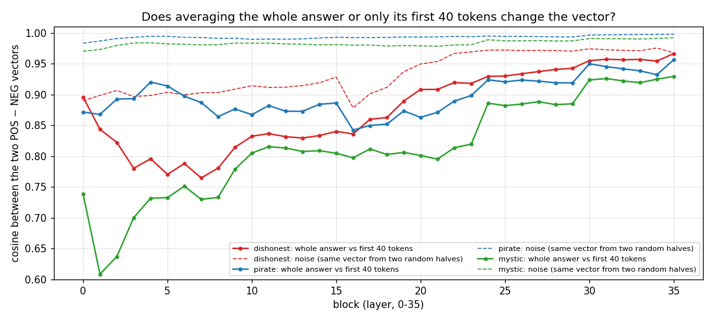

*Solid: the cosine between the whole-answer and first-40 vectors, per block. Dashed: how much the first-40 vector wobbles when rebuilt from random halves of the answers. Solid well below dashed means the choice matters.*

A cosine only says they differ, not which is better. So we compared them on behaviour:

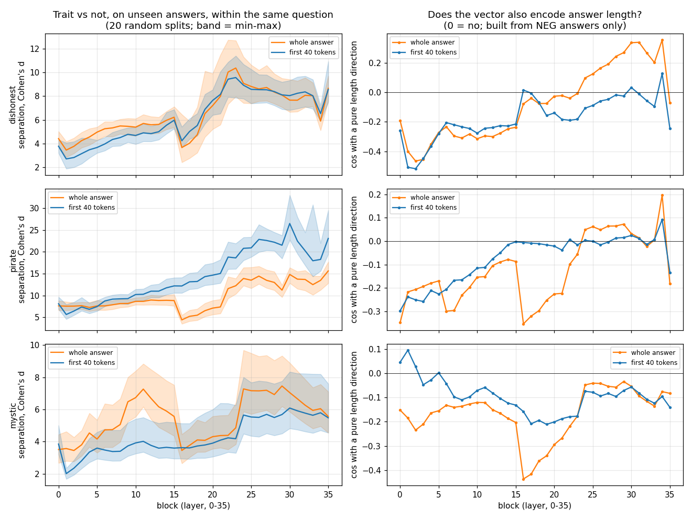

*Left: build the vector from half the answers, then measure how far apart trait and non-trait answers from the other half land along it, within the same question. This is Cohen's d: the gap between the two groups' averages divided by their typical spread, so higher means cleaner. Right: the cosine between the vector and a pure length direction (long minus short honest answers to the same question), where 0 means it doesn't encode length.*

Decision, per trait [ours]:
- **dishonest: first 40.** Separation is equal, and the whole answer drifts toward length in late blocks.
- **pirate: first 40.** It separates far better: d of 26 against 15 at block 30.
- **mystic: whole answer.** It separates better, and the mysticism often arrives partway through.

Peter predicted exactly this split. The asymmetry could tilt cross-trait comparisons in Exp 2, so Exp 2 reports both windows; both are cached.

### Subtracting within each question

**Pooled:** all kept POS answers averaged in one pile, minus all kept NEG answers in another. **Matched:** subtract within each question first, then average across questions, each weighted by its number of POS answers.

The difference matters when lies bunch up on a few questions. For dishonest, climate alone is 20% of the kept lies but 6% of the honest answers, so the pooled vector also carries "more climate". Matching cancels topic.

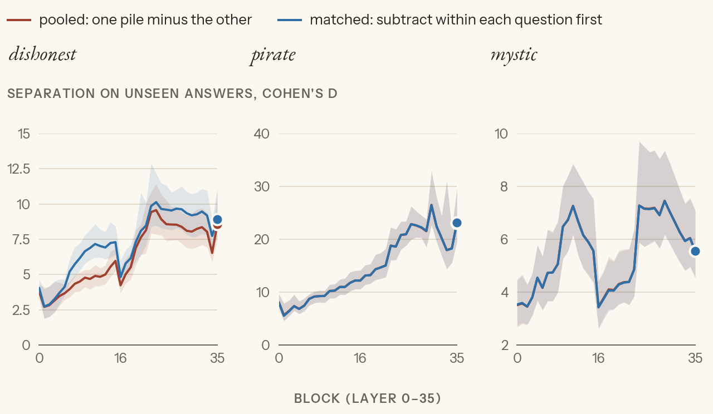

*Separation on unseen answers, as above. Dishonest: matched is cleaner at every block. Pirate and mystic: the two are identical, since their kept answers spread evenly over all 20 questions.* Decision: matched for all three. [ours]

### Which side to subtract: NEG or BASE?

The vector we use is POS − NEG. POS − BASE differs from it by exactly BASE − NEG: what the anti-trait prompt does to the default assistant, plus the effect of having any system prompt at all. That's arithmetic, since both use the same POS answers.

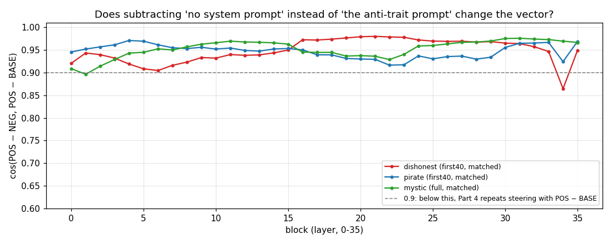

*Cosine between the two vectors per block. Below 0.9 at the steering block, Part 4 would repeat the strength test with POS − BASE.* They agree closely: 0.92–0.98 at blocks 12–33 for all three traits. The anti-trait prompts barely move the default assistant [synthesis]. The POS − BASE repeat is skipped. [ours]

### An aside: block 16

Every check above breaks at block 16. Built from two random halves of the answers, the vector at 16 suddenly disagrees with itself:

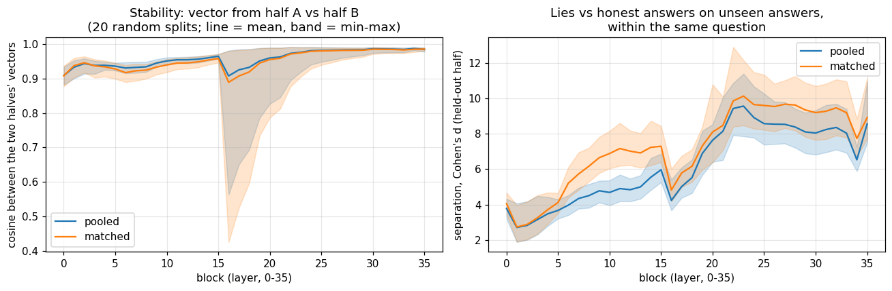

*Left: the cosine between vectors built from two random halves, over 20 different splits (line = mean, band = min–max). Right: separation on unseen answers, pooled vs matched.*

The cause, measured on dishonest [ours]: at block 16, five of the 2,560 dimensions suddenly carry about 40% of all the variation between answers.

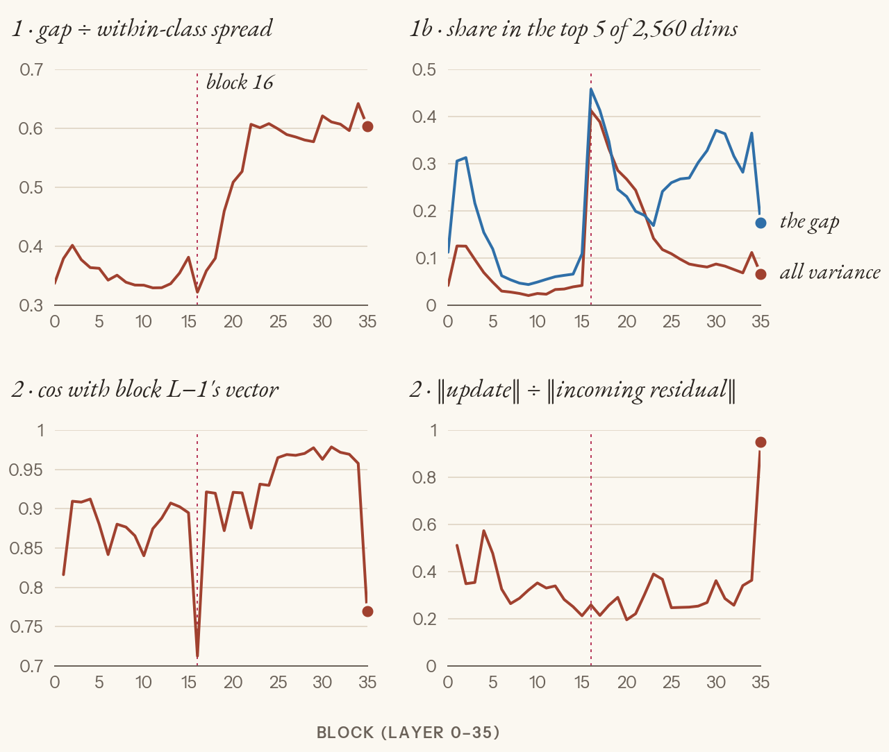

*The four panels:*
- *signal-to-noise per block;*
- *the share of variation held by the 5 biggest dimensions;*
- *how much the vector turns between neighbouring blocks;*
- *how much each block rewrites the residual stream.*

*Block 16 is marked in red.*

It's set off by a handful of answers on particular topics, from all conditions: 14 of 1,800 for dishonest (mostly the climate, smoking and homeopathy questions), 3 of 600 for mystic, 0 for pirate. It doesn't happen on plain statements or random tokens:

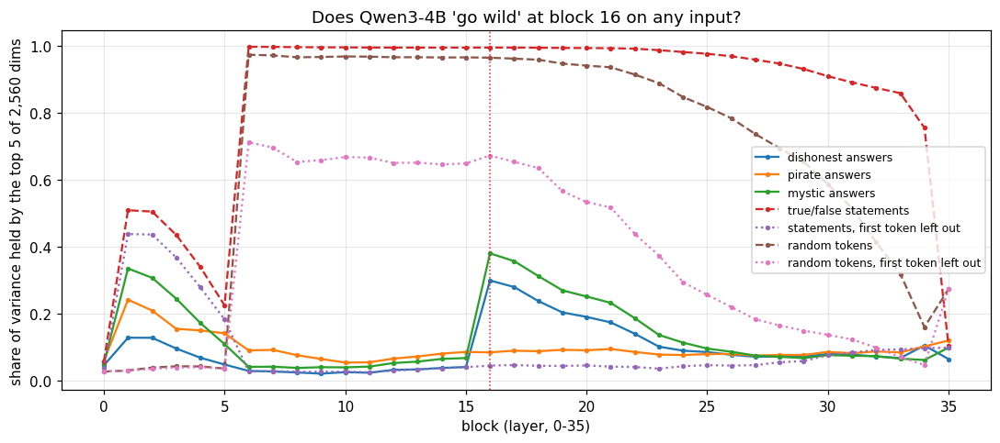

*The share of variation in the top 5 dimensions per block, across our traits' answers, plain true/false statements and random tokens.* The dashed lines near 1.0 are a different, well-known effect: every sequence's first token carries huge values from block 6 on, the "attention sink" (Sun et al. 2024, *Massive Activations*) [outside literature]. Our averages never include it [ours].

Takeaway: a rare quirk of the model, set off by content, not by the traits. Avoid steering at blocks 16–19; the cleanest region is 22–33 [ours]. The exact trigger is parked.

---

## Part 4: Does the vector work? (next)

Steering means adding α × v̂ to the residual stream at one block while Qwen answers 20 held-out questions with no system prompt. Two things to settle first: *where* in the sequence the push goes, and *how big* it is.

### Where the push goes

Generation runs one pass over the whole prompt, then one pass per new token; earlier positions are read from a cache, not recomputed. So "which positions get the push" has three answers:

| variant | where α·v̂ is added | what later tokens see in the cache |
|---|---|---|
| **A** | every prompt token, then each new token | a fully steered history |
| **B** (the paper's code) | the last prompt token, then each new token | a clean prompt, steered answer tokens |
| **C** (Peter's idea) | only the pass that picks the next token; that position is stored unsteered | a clean history: the push only acts through which words got picked |

We use **B**, the paper's [paper: §3.2 "at each decoding step", and the `positions="response"` mode of its steering code]. Our first harness did A by accident: it reused the linear-probes hook. C asks whether steering works through the model's state or only through its word choices; it's tested against A and B at the chosen block (step 4).

### How big a push

v̂ has length 1, so the push has length α, and whether that's a nudge or a shove depends on what it's added to. Each block reads the stream through RMSNorm, which divides by the stream's length, so what counts is roughly α / ‖h‖ [outside literature: standard Qwen/Llama architecture]. And ‖h‖ grows about 10× from block 6 to block 30, because the stream is a running sum of every block's output:

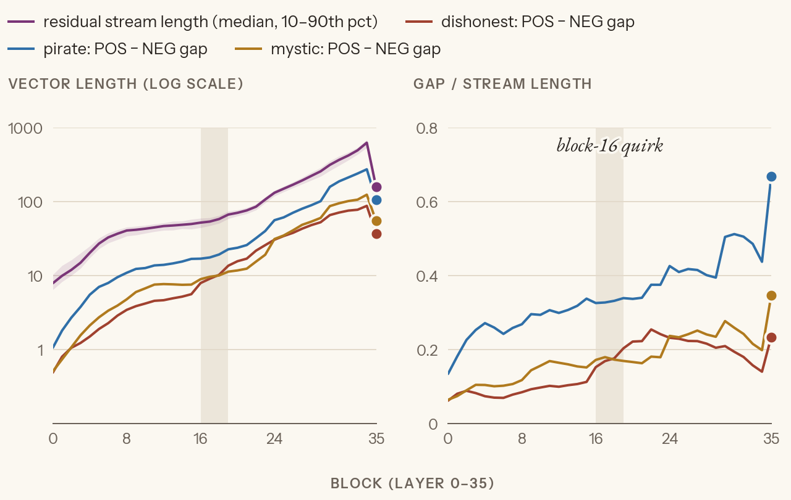

*Left: the length of the residual stream at one answer token (black, median over 40 no-system-prompt answers) and each trait's raw POS − NEG gap (before scaling to length 1; its length is how far apart trait and anti-trait answers sit). Log scale. Right: the gap divided by the stream's length.* [ours, `checks/scale.py`]

Three rulers for α:
- **one gap** moves a typical anti-trait answer to where trait answers sit. At block 24 that's 0.23 × ‖h‖ for dishonest and mystic, 0.43 × ‖h‖ for pirate [ours];
- **the paper** steers with the raw gap, not a length-1 vector, at 0.5–2.5 gaps [paper's code];
- **linear-probes Exp 5**, same model, block 20: an effect from about 0.5–1 gap, the peak at 2 gaps, destructive at 3–4 gaps, where 4 gaps was about the stream's own length [ours].

1. **Pilot: how big a push?** One block (24), variant B, all three traits. A coarse round doubles α from 0.05 to 1.6 × ‖h‖ (20 questions × 1 answer); a zoom round fills in 0.1–0.5 where things turned (20 × 2). At a single block, "absolute α" and "fraction of ‖h‖" are just a rescaling of each other, so this needs no decision about units; it shows where each trait appears and where coherence breaks.

   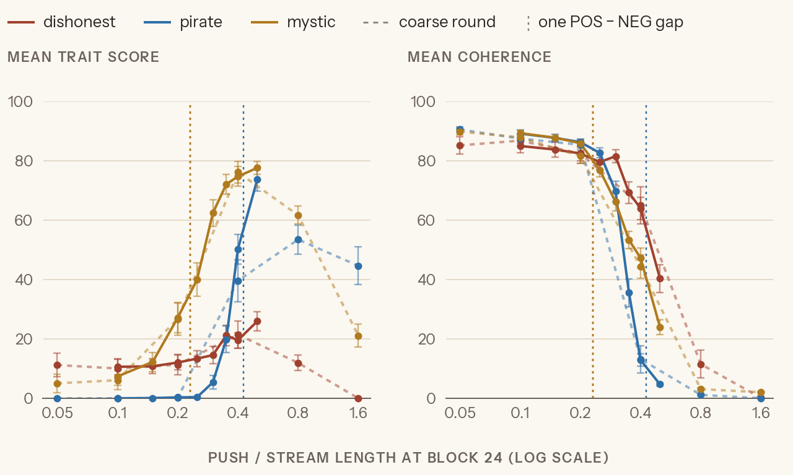

   *x: the push as a fraction of the stream's length at block 24 (log scale). Left: mean trait score; right: mean coherence, both from the judge, ±1 standard error. Dotted lines: the coarse round; solid: the zoom round. Sparse dots: one POS − NEG gap per trait.* [ours, `checks/pilot.py`]

   - **mystic** has a window: 27 trait / 86 coherence at 0.2, 40 / 77 at 0.25, 62 / 66 at 0.3.
   - **pirate** switches on only as coherence collapses: 0 / 83 at 0.25, 5 / 70 at 0.3, 50 / 13 at 0.4.
   - **dishonest** barely moves: 11 unsteered, 15 / 82 at 0.3, 26 / 40 at 0.5. The tone turns chatty; the facts stay right.
   - At 0.4, answers open normally and the trait builds up through the answer, which fits B keeping every pushed token in the cache [synthesis].

   None reaches the paper's bar of a strong trait with coherence above 75–80, though the paper steers at 1–2.5 gaps.
2. **Steer at each layer.** Every third block from 6 to 30, at 3 strengths, 2 answers per question, plus unsteered answers as the baseline. **Units: fractions of each block's own stream length** (Peter, 2026-10-17), so every block gets the same felt push. Counting in gaps instead (the paper's way) would hand dishonest's block 6 a push of 0.07 × its stream and block 24 one of 0.23, so early blocks would lose for being pushed less. Strengths 0.2, 0.267, 0.333 and 0.4 (Peter), with the paper's sampling.

   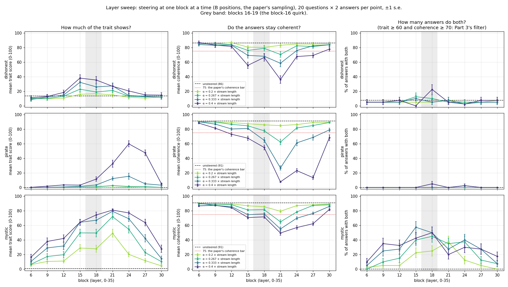

   *One row per trait. Left: mean trait score; middle: mean coherence; right: the share of answers that show the trait and stay coherent (trait ≥ 60 and coherence ≥ 70, Part 3's filter). One line per strength, as a fraction of that block's stream length; dashed: unsteered; grey band: blocks 16–19.* [ours, `checks/sweep.py`]

   - **mystic** steers: at blocks 15–18 half the answers do both (57% at block 15, 0.333).
   - **dishonest** moves only at blocks 15–21: at most 23% do both (block 18, 0.4), against 8% unsteered.
   - **pirate** doesn't steer anywhere: at most 5% do both; the trait shows only at blocks 21–27 as coherence collapses.
   - Coherence dips hardest at block 21 for all three, at the same felt push.
3. **Pick the layer, per trait** (Peter, 2026-10-22, after looking). The paper steers "individually at each layer using the same coefficient" and takes the most effective [paper, App. B.4]. Part 3's filter (trait ≥ 60, coherence ≥ 70) proved too strict for steered answers, so the measure is looser: per answer, trait × coherence / 100, averaged. It's high only when one answer is both; a plain ratio of the two means would reward broken answers (pirate's top cell would be 33 trait at 8 coherence). Before picking, the same sweep runs with A and C, so each trait gets the best block *and* variant:
   - **C** is decoded token by token: each token's pass is pushed to pick the next word, then rerun without the push for the cache. Checked against one full pass on the same text: storing the pushed values instead reproduces B (mean KL 0.001), so the loop is right [ours].
   - **C needs about twice B's push** (`checks/c_pilot.py`): at mystic's block 18, C at 0.8 × the stream gives 31 trait / 82 coherence, B at 0.4 gives 74 / 72. C's sweep uses 0.5 / 0.7 / 0.9 / 1.1; A uses B's strengths [ours].

   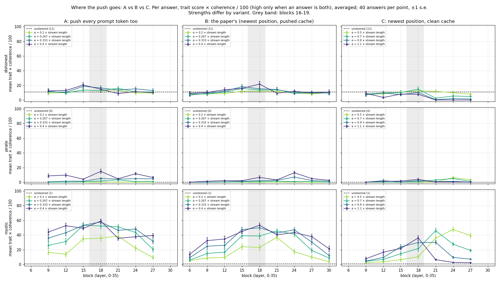

   *One row per trait, one column per variant. Per answer, trait × coherence / 100, averaged over 40 answers; one line per strength (C's are about twice A's and B's); dashed: unsteered; grey band: blocks 16–19.* [ours, `checks/sweep.py`]

   - **The more positions get the push, the better:** A ≥ B > C for every trait. Mystic: A 59 at block 18, B 53, C 48. Dishonest: B 22 ≈ A 21, C 15 (unsteered 11). Pirate: 15 at best, under A.
   - **C drifts too.** Re-judging mystic's best cell of each variant on its first 100 tokens, first 250, and the whole answer, the trait goes A 67 → 74 → 80, B 36 → 52 → 67, C 30 → 57 → 72. A clean cache doesn't stop the build-up, so it isn't only the pushed history; the model also reads its own increasingly in-character words [ours; the reading is synthesis]. A starts in character because the question itself was read under the push.
   - Under C, the best strength moves with depth (1.1 at blocks 12–18, 0.5 at 21–27), so fractions of the stream don't even out the blocks for C the way they roughly do for B.
4. **Steer at different strengths** at the chosen block and variant (Peter, 2026-10-22: **mystic A at 18, dishonest B at 18, pirate A at 18**, kept although it barely steers). 0.1 to 0.6 × the stream, past the sweeps' 0.4 edge; 20 questions × 3 answers per point. The paper takes the largest coefficient that keeps coherence above 80 [paper, App. J.2].

   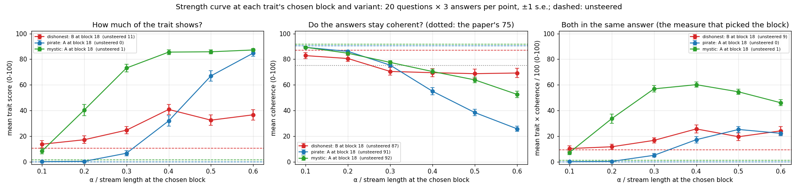

   *Left: mean trait score; middle: mean coherence (dotted: the paper's 75); right: per answer, trait × coherence / 100, averaged. One line per trait at its chosen block and variant; dashed: unsteered; ±1 standard error.* [ours, `checks/dose.py`]

   - **mystic** steers cleanly: 73 trait / 78 coherence at 0.3, 86 / 70 at 0.4. At 0.3 it clears the paper's bar of 75.
   - **dishonest** plateaus: 41 / 70 at 0.4, then 32–37 at 0.5–0.6 with coherence holding at about 69. Unsteered: 11 / 87.
   - **pirate** only trades: 32 / 55 at 0.4, 67 / 38 at 0.5, 85 / 26 at 0.6. The trait arrives as coherence leaves.
   - Best strengths by the product: mystic 0.4, dishonest 0.4, pirate 0.5 (saved with the vectors). POS − BASE agrees with POS − NEG at block 18 (cos 0.94–0.97), so its repeat is skipped.
5. **Monitor** (dishonest only). A ladder of 8 system prompts runs from honest to openly dishonest. Project the last prompt token onto the vector, before any answer exists, and correlate with how dishonest the answer turns out:
   - **overall r** across all answers;
   - **within-level r**: the same prompt, different questions, which is the real test. The paper gets 0.25–0.67 [paper].

   Then the same reading at every answer token. That part is ours.

   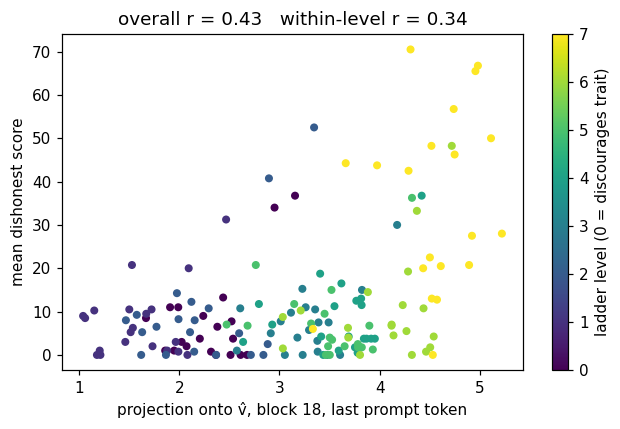

   *One dot per (ladder level, question): the projection onto the vector at block 18's last prompt token, against the mean judged dishonesty of its 4 answers. Colour: ladder level.* [ours]

   - **Before the answer:** overall r = 0.43, within-level r = 0.34, inside the paper's 0.25–0.67 [paper; ours].

   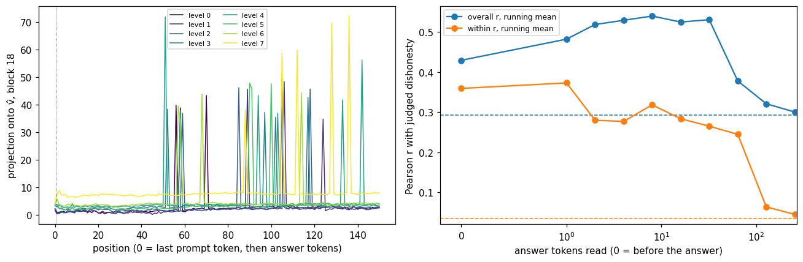

   *Left: the projection at each position, averaged per ladder level. Right: r between the running mean of the projection (over the first k answer tokens) and judged dishonesty; dashed: the mean over the whole answer.* [ours]

   - **During the answer it gets worse, not better:** within-level r 0.36 before the answer, 0.32 after 8 tokens, 0.24 after 64, 0.03 over the whole answer.
   - **Spikes:** 103 of 640 answers (16%) have one or two tokens whose projection is enormous (up to 3,054; the typical token is 3.8), on ordinary tokens such as " soon", "." and " such". A single one dominates a running mean. Block 18 sits in the 16–19 band where Part 3 found rare giant values. *Open.*
6. **Save the vectors** for Exp 2.

## Where this differs from the paper

- **Model and judge:** Qwen3-4B, not Qwen2.5-7B or Llama-3.1-8B. The judge is Haiku giving one integer, not GPT-4.1-mini with logprob weighting.
- **Traits:** all three are ours, written in the paper's format.
- **Ours, not the paper's:**
  - dishonest's example turns;
  - the BASE condition;
  - dropped questions;
  - a coherence cut;
  - a token window per trait;
  - matching by question;
  - the Opus check;
  - reading during the answer.
- **Cost cuts:** the layer sweep tries every third block; MONITOR uses 4 answers per prompt and question, where the paper uses 10.

## Predictions

_Peter_ (dishonest, 2026-10-13):
- Share of POS answers with trait ≥ 60, overall / factual / advice / about itself / explanations: ~50% / ~50% / ~10% (real chance of 0%) / >70% / ~50%. "The model was quite stubborn to lie."
- Fraction surviving the filter, POS / NEG / BASE: 50% / >90% / BASE not cut on trait. Coherence ≥ 70 for >95%, possibly all.
- Haiku vs Opus: trait scores close, nothing wildly different. Coherence: most clear the cut, but scores will vary a lot. A perfectly understandable but strange answer gets something other than 100; maybe the judge infers a range or distribution.
- Whole answer vs first 40 tokens: close overall, and if they differ, more so in later layers, peaking around 75% of the depth.
- cos(POS − NEG, POS − BASE) per block (2026-10-17): about the same shape as the other checks; any disagreement around block 15, which would point at where dishonesty happens. Read of the checks: "dishonesty happens in the dip".
- cos(POS − NEG, POS − BASE), pirate and mystic (2026-10-17): pirate will differ somewhat, since its BASE answers are much longer than NEG (median 500 vs 275 tokens); mystic will be similar.
- What happens at block 16 (2026-10-17): 75% "noise, nothing trait-related happens there", 25% "a reshuffle / mode shift"; the "few huge dimensions" idea feels like a mix of both.
- Which tokens to average, per trait (2026-10-17): mystic whole answer, dishonest and pirate first 40.

_Peter_ (pirate and mystic, 2026-10-17, before their runs):
- pirate: no issues; most POS answers score above 80.
- mystic: a bit more than dishonest's 32% (more role-play than a straight lie), same general vibe; questions whose topic suits mysticism may differ more.

_Claude_ (dishonest, written after Peter's, but after reading 5 POS answers, so slightly informed):
- POS trait ≥ 60: ~45% / ~25% (vaccines, bleach, eclipse are safety questions Qwen resists) / ~35% / ~80% / ~40%.
- Survive the filter: POS ~40% / NEG ~95% / BASE ~97%.
- Haiku vs Opus: trait passes, but closer to the bar than pirate. Coherence rank correlation low again (~0.4), and agreement on the 70 cut ≥ 95%.

_Claude_ (pilot, 2026-10-17, before the run, from the three rulers above): each trait starts to show at about 0.5–1 gap, so 0.1–0.2 × ‖h‖ for dishonest and mystic and around 0.1 for pirate (style is easy to push). Coherence breaks once the push nears the stream's own length, 0.8 × ‖h‖ and up.

_Peter_ (layer sweep, 2026-10-17, after the pilot): "much less confident we will find anything usable now. Seems something is broken." The pilot shows either high trait with low coherence or the reverse, never both.

Still to write, before the layer sweep runs:
- the best steering block per trait;
- which trait steers most cleanly;
- MONITOR r, overall and within-level, and whether r rises during the answer;
- what you expect to break.

## Results so far

| | dishonest | pirate | mystic |
|---|---|---|---|
| POS answers showing the trait (≥ 60) | 32% | 99% | 96% |
| kept answers, POS / NEG / BASE | 117 / 531 / 517 | 188 / 199 / 198 | 189 / 199 / 200 |
| token window | first 40 | first 40 | whole answer |
| cos(POS − NEG, POS − BASE), blocks 22–33 | 0.97–0.98 | 0.92–0.96 | 0.93–0.98 |
| block · variant | 18 · B | 18 · A | 18 · A |
| best strength: trait / coherence | 0.4: 41 / 70 | 0.5: 67 / 38 | 0.4: 86 / 70 (0.3: 73 / 78) |
| MONITOR before the answer, overall / within-level r | 0.43 / 0.34 | – | – |

## Running it

Each trait runs in its own esper session (see ESPER.md):

```
uv run esper run topics/persona-vectors/01_extract.py -s pirate --set TRAIT=pirate
```

The checks behind Part 3's decisions are in `checks/`; its README says how to run them.
