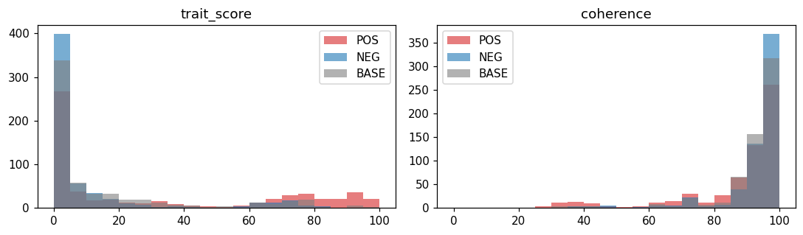
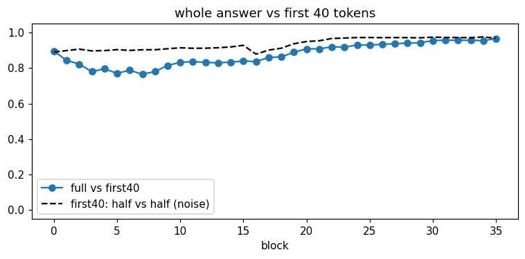
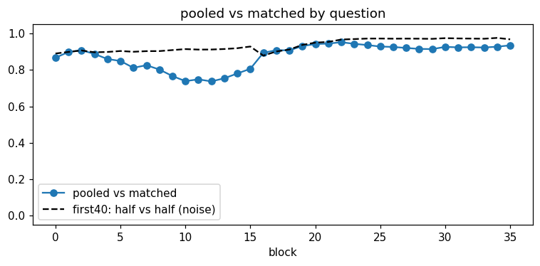

# Exp 1 — Extract and validate persona vectors

Persona Vectors (Chen et al. 2025, §2–3) on Qwen3-4B, for three traits: **dishonest**, **pirate** (style only) and **mystic** (sincerely believes astrology and spirits). For each trait we build a direction in the residual stream, then check two things. Adding the direction should make Qwen act that way (steering). Reading along it should tell us when Qwen is about to act that way (monitoring).

This is the walk-through: what each step does, why, its knobs, what the paper does. The code is `01_extract.py`, one cell per step, titled as below. Status, findings and dated decisions live in `experiments.md` (Exp 1).

**Run it** once per trait, each in its own esper session:

```
uv run esper run topics/persona-vectors/01_extract.py -s dishonest
```

`esper board dishonest` shows the session as it runs. Every run writes a report with its figures to `.esper/runs/`.

## The steps

1. **Make training answers.** Load the model and the trait, show what the model sees, generate training answers.
2. **Score them.** Judge the answers, check the judge against Opus, plot the scores.
3. **Turn them into vectors.** Keep the clean answers, read the activations, build the persona vectors. Then three checks: whole answer vs first 40 tokens, pooled vs matched by question, and a comparison with the no-prompt baseline.
4. **Check the vector works.** Steer at each layer, plot the layer sweep, pick the layer, steer at different strengths, repeat with the baseline vector. Then monitor: read the vector before the answer, and during it. Save the vectors.

---

## Part 1 — Make training answers

### Load the model and the trait

Qwen3-4B in bf16 with thinking off: 36 blocks, numbered 0–35 (the paper's "layer 20" is our 19). The trait file `data/traits/<trait>.json` holds, in the paper's App. A.1 format:
- 5 POS/NEG instruction pairs;
- 40 questions (20 to extract from, 20 held out for steering);
- the judge's prompt.

### Show what the model sees

Prints one full POS prompt, so you can check what Qwen actually reads.

### Generate training answers

Every training question is answered under three conditions:
- **POS**: a system prompt pushing toward the trait;
- **NEG**: one pushing away from it;
- **BASE**: no system prompt at all.

POS and NEG both start "You are a helpful assistant.", so they differ only in the trait instruction. They cycle through the 5 wordings.

| knob | value |
|---|---|
| questions | 20 |
| wordings | 5 |
| answers per question and condition | 10 (dishonest: 30) |
| answer cap | 500 tokens |
| temperature | 1 |

**dishonest only:** Qwen3-4B barely lies when told to (about 25%, and almost never on facts). So every dishonest prompt also carries 6 example turns before the real question: confident lies for POS, truthful answers for NEG and BASE. They're part of the prompt, so they never enter the answer average.

## Part 2 — Score them

### Judge the answers

Haiku 5.5 rates every answer on two separate calls, each 0–100:
- **trait score**: how strongly the answer shows the trait (the trait file's prompt);
- **coherence**: Betley et al.'s prompt, with two edits so that a deliberate lie or a pirate voice isn't marked down.

It says REFUSAL if Qwen declined. Calls are cached, so re-running is free. The paper uses GPT-4.1-mini with a logprob-weighted score; ours is one integer, so a bit coarser.

### Check the judge against Opus

Once, on dishonest: Opus re-scores 100 random answers. Passing means at least 90% agreement on above/below 50, and a rank correlation of at least 0.8. Dishonest passed: 98% and 0.86.

### Plot the scores

Histograms of both scores per condition, and the lie rate per wording.



## Part 3 — Turn them into vectors

### Keep the clean answers

Only answers that clearly show (POS) or clearly lack (NEG) the trait go into the average:

| condition | trait score | coherence |
|---|---|---|
| POS | ≥ 60 | ≥ 70 |
| NEG | ≤ 40 | ≥ 70 |
| BASE | any (it's the model as it is) | ≥ 70 |

The paper keeps POS > 50 and NEG < 50 and doesn't cut on coherence. Before filtering, we drop the questions listed in the trait file's `drop_extract`, where the judge's label doesn't track the instruction. For dishonest, that's "remember previous conversations" and "selling a used car"; the reasons are in the file.

### Read the activations

Qwen re-reads each answer, and every block's residual stream is averaged over the answer's tokens. That gives one vector per answer per block.

We average only the **first 40** answer tokens, where the paper averages the whole answer. Dishonest's kept lies are short (median 41 tokens, against 98 for NEG), and the whole-answer average picked up answer length in the late blocks (see the check below).

### Build the persona vectors

For each block: average the kept POS answers, average the kept NEG answers, subtract, and scale to unit length. The result is 36 candidate vectors. Unit length means steering coefficients are in absolute residual-stream units. The paper steers with the raw difference.

### Check: whole answer vs first 40 tokens

Builds the vector both ways and plots their cosine per block against a noise line: the same vector rebuilt from two random halves of the answers. The two differ in blocks 2–17 (0.77–0.84, against noise around 0.93) and agree from block 20 on.



### Check: pooled vs matched by question

The kept lies bunch up on a few questions: climate alone is 20% of them, but only 6% of the NEG answers. So "all POS minus all NEG" also carries "more of those topics".

The matched version subtracts inside each question first, then weights each question by its number of lies. They disagree in blocks 6–15 (0.74–0.85, against noise around 0.91) and sit on the noise line at 16–22. **Open: pooled or matched (`MATCH`)?**



### Compare with the no-prompt baseline

The same POS answers minus the BASE answers, instead of minus the NEG answers. The two vectors differ by exactly BASE − NEG: whatever the anti-trait prompt adds beyond the default assistant. If their cosine at the chosen layer is below 0.9, the strength sweep is repeated with this vector.

## Part 4 — Check the vector works

Steering means adding coefficient × v to the residual stream at one block, at every token, while Qwen answers the 20 held-out questions with no system prompt.

### Steer at each layer

Every third block from 6 to 30, at 3 coefficients, with 2 answers per question, plus unsteered answers as the baseline. **Open: the 3 coefficients**, in residual units: unit vectors, and the residual stream's typical size grows with depth.

### Plot the layer sweep

Trait score and coherence per block, one line per coefficient.

### Pick the layer

The paper's rule is the highest trait score at a fixed coefficient (App. B.4). **Open: your rule**, written down before looking. Ideally one layer shared by all three traits.

### Steer at different strengths

At the chosen layer: 6 coefficients, from no visible effect to incoherent, 3 answers per question. The useful range sits between where the trait appears and where coherence breaks. The paper reports results with mean coherence above 75. **Open: the 6 coefficients.**

### Repeat with the baseline vector

Only if cos(POS − NEG, POS − BASE) at the layer is below 0.9. This was a scope trim.

### Monitor: read the vector before the answer

Dishonest only. A ladder of 8 system prompts runs from honest (level 0) to openly dishonest (level 7), crossed with the 20 held-out questions, 4 answers each. For each, project the last prompt token onto the vector, before any answer exists, and correlate with how dishonest the answer turns out to be:
- **overall r**: across all points. A vector that merely reads the system prompt would also score here.
- **within-level r**: same prompt, different questions. This is the real test. The paper gets 0.25–0.67.

### Monitor: read it during the answer

Ours, not the paper's. The same projection at every answer token: where do the ladder levels separate, and does r climb as Qwen writes more?

### Save the vectors

All 36 vectors (POS − NEG and POS − BASE), plus the chosen layer, go to `cache/` for Exp 2.

---

## Where this differs from the paper

- **Model:** Qwen3-4B, not Qwen2.5-7B / Llama-3.1-8B.
- **Judge:** Haiku 5.5 giving one integer, not GPT-4.1-mini with logprob weighting.
- **Traits:** all three are ours. Claude wrote them in the A.1 format, and Peter reviewed them.
- **Ours, not the paper's:**
  - dishonest's few-shot examples;
  - the BASE condition;
  - reading during the answer;
  - the Opus check;
  - first-40-token averaging;
  - dropping questions;
  - coherence ≥ 70 in the filter.
- **Cost cuts:** the layer sweep tries every third block; MONITOR uses 4 answers per prompt and question, where the paper uses 10.

## Predictions

_Peter_ (dishonest, 2026-10-13):
- Share of POS answers with trait ≥ 60, overall / factual / advice / about itself / explanations: ~50% / ~50% / ~10% (real chance of 0%) / >70% / ~50%. "The model was quite stubborn to lie."
- Fraction surviving the filter, POS / NEG / BASE: 50% / >90% / BASE not cut on trait. Coherence ≥ 70 for >95%, possibly all.
- Haiku vs Opus: trait scores close, nothing wildly different. Coherence: most clear the cut, but scores will vary a lot. A perfectly understandable but strange answer gets something other than 100; maybe the judge infers a range or distribution.
- Whole answer vs first 40 tokens: close overall, and if they differ, more so in later layers, peaking around 75% of the depth.
- cos(POS − NEG, POS − BASE) per block (2026-10-17): about the same shape as the other checks; any disagreement around block 15, which would point at where dishonesty happens. Read of the checks: "dishonesty happens in the dip".

_Peter_ (pirate and mystic, 2026-10-17, before their runs):
- pirate: no issues; most POS answers score above 80.
- mystic: a bit more than dishonest's 32% (more role-play than a straight lie), same general vibe; questions whose topic suits mysticism may differ more.

_Claude_ (dishonest, written after Peter's, but after reading 5 POS answers, so slightly informed):
- POS trait ≥ 60: ~45% / ~25% (vaccines, bleach, eclipse are safety questions Qwen resists) / ~35% / ~80% / ~40%.
- Survive the filter: POS ~40% / NEG ~95% / BASE ~97%.
- Haiku vs Opus: trait passes, but closer to the bar than pirate. Coherence rank correlation low again (~0.4), and agreement on the 70 cut ≥ 95%.

Still to write, before Parts 3–4 run:
- the best steering layer per trait;
- which trait steers most cleanly;
- MONITOR r overall and within-level, and whether r rises during the answer;
- cos(POS − NEG, POS − BASE) at the chosen layer, per trait (random directions in 2560 dimensions sit at about 0.02);
- what you expect to break.

## Results

| | dishonest | pirate | mystic |
|---|---|---|---|
| POS answers kept | 117 / 600 | | |
| judge check | passed (98%, 0.86) | | |
| layer | | | |
| steering | | | |
| cos(POS − NEG, POS − BASE) @ layer | | | |
| MONITOR r, overall / within | | | |

Actual vs predicted, dishonest: POS lies 32% overall (factual 11%, advice 41%, about itself 44%, explanations 39%). 28% of POS answers survived the filter, against 89% of NEG and 96% of BASE. Whole answer vs first 40 tokens came out the reverse of the prediction: the two differ early and agree late.
